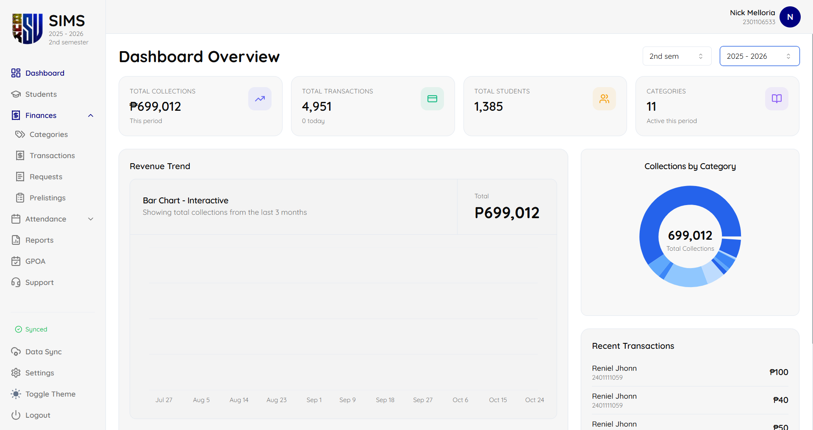
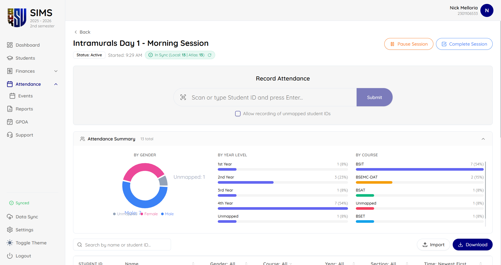

# SBO-SIMS — Student Information Management System

A multi-tenant, offline-capable Student Information & Fee Management System designed for Student Body Organizations (SBO), student councils, academic departments, and campus organizations. SBO-SIMS streamlines student masterlists, fee collections, event attendance tracking via barcode scanner, payment requests, GPOA planning, and reporting with bidirectional offline-to-cloud synchronization.

Available as both a **Web Application** and an **Offline-First Desktop App (Electron)**.

---

## Screenshots

|                           Dashboard & Metrics                           |                         Real-Time Attendance Scanner                          |
| :---------------------------------------------------------------------: | :---------------------------------------------------------------------------: |
|  |  |

---

## Key Features

### Multi-Tenancy & Academic Term Scoping

- **Strict Tenant Isolation**: Complete data segregation by organization via slug headers (`x-organization-slug`).
- **Academic Term Scoping**: Temporal filtering by Semester and School Year across students, transactions, events, and reports.
- **Cross-Organization Sync**: Organizations can synchronize eligible enrolled student lists from parent or related organizations.

### Offline-First Synchronization Engine (Electron Desktop)

- **Local MongoDB Embedded**: Desktop app runs an embedded local database daemon (`mongod.exe`) allowing officers to collect fees and scan attendance completely offline (e.g., during campus events or remote booths).
- **Bidirectional Sync with MongoDB Atlas**: Changes are logged locally into operation logs (`pending` → `in_flight` → `synced`) and automatically pushed/pulled to/from Atlas with field-level Last-Write-Wins (LWW) conflict resolution upon internet restoration.
- **Auto Proxy Authentication & First-Run Bootstrap**: Automatically bootstraps cloud organizations, users, and term databases for new desktop installations.

### Student Masterlist Management

- Comprehensive profiles: Student ID, name, course, year level, section, and gender.
- **Smart Excel & CSV Importer**: Auto-detects columns, handles multiple header naming conventions, extracts IDs from institutional emails (`studentID@domain`), verifies uniqueness, and provides interactive preview tables before importing.
- Multi-organization enrollment mapping under a single unified student ID.

### Fee Categories, Prelisting & Transactions

- **Flexible Fee Categories**: Define mandatory or optional fees, target courses, and custom fee breakdowns.
- **Prelisting**: Assign eligible fee checklists to students for targeted batch collections.
- **Transaction Recording**: Quick payment entry with instant status updates and printable receipts.
- **Smart Bulk Transaction Import**: Import batch payment records via Excel or CSV with automated student matching and duplicate detection.
- **Exportable PDF Reports**: Automated generation of transaction summaries and audit trails.

### Event Management & Attendance Tracking

- **Multi-Session Events**: Create events with configurable sessions (upcoming, active, paused, completed).
- **High-Speed Barcode / ID Scanner**: Global keydown auto-capture designed for physical barcode scanners, giving instant visual confirmation and sound cues.
- **Bulk Attendance Import**: Import attendance sheets from Excel/CSV with automatic student ID detection, masterlist verification, and conflict skipping.
- **Demographic Statistics**: Real-time breakdown of attendees by course, year level, and gender.
- **Attendance Export**: Export filtered attendance records directly into formatted PDF or CSV/Excel files.

### Student Portal (`/student`)

- **Dedicated Student Experience**: Separate authenticated portal for enrolled students.
- **Personal Dashboard**: Track payments, remaining balances, attended events, and organizational announcements.
- **Digital Payment Requests**: Submit payment proofs and transaction requests online with receipt uploads for officer verification.
- **General Plan of Action (GPOA)**: View organizational activities and progress reports.
- **Term Switcher**: Inspect historical payments and records across past semesters and school years.

### Granular Role-Based Access Control (RBAC) & Central Admin

- **Three Macro-Roles**: `central-admin`, `org-admin`, and `student`.
- **Custom Officer Roles**: Granular module permissions for organization officers (`student:create`, `transaction:import`, `attendance_record:download`, etc.).
- **Global Central Admin Portal (`/admin`)**: Central system management, sync source configuration, and global settings.
- **Integrated Support Desk**: Ticketing and support thread system between organization officers and central administrators.

### Modern UI & Customization

- Built with Tailwind CSS and Radix UI / Shadcn UI components.
- Dark & Light mode theme support.
- Organization branding color customizations.
- Responsive design with adaptive card layout for mobile screens and dense data tables for desktop.

---

## Tech Stack

### Client (Web & Desktop UI)

- **Framework**: React 18 with TypeScript
- **Bundler & Tooling**: Vite, PostCSS, Tailwind CSS
- **Component Library**: Radix UI primitives & Shadcn UI
- **State Management**: TanStack React Query (server state), Zustand (client UI/theme state)
- **Forms & Validation**: React Hook Form, Zod
- **Icons & Styling**: Lucide React, Class Variance Authority (`cva`)
- **Document Generation**: jsPDF, html2canvas

### Desktop Harness (Electron)

- **Runtime**: Electron
- **Sync Engine**: Custom Node.js background orchestrator with clock-skew detection
- **Packaging**: `electron-builder` with NSIS installer targets
- **Updates**: `electron-updater`

### Server & API

- **Runtime**: Node.js & Express with TypeScript
- **Database**: MongoDB with Mongoose ODM
- **Spreadsheet Parsing**: ExcelJS & `csv-parser`
- **File Uploads**: Multer & Cloudinary
- **Authentication**: JWT (JSON Web Tokens) with refresh token rotation & `bcryptjs`
- **PDF & Templating**: Puppeteer & EJS

---

## Getting Started

### Prerequisites

- [Node.js](https://nodejs.org/) (v18.x or v20.x recommended)
- [MongoDB](https://www.mongodb.com/try/download/community) installed and running locally on port `27017` (or Docker)
- [Git](https://git-scm.com/)

---

### Method 1: Local Development (Web + Server + Database)

1. **Clone the repository**:

   ```bash
   git clone https://github.com/FiereEinar/sbo-sims.git
   cd sbo-sims
   ```

2. **Install all dependencies across root, server, and client**:

   ```bash
   npm run install-all
   ```

3. **Configure Environment Variables**:
   - Copy or create `server/.env` based on `server/.env.sample`:
     ```env
     PORT=3000
     ME_CONFIG_MONGODB_URL=mongodb://localhost:27017
     MONGODB_NAME=sbo-sims
     BCRYPT_SALT=10
     JWT_SECRET_KEY=your_jwt_secret
     JWT_REFRESH_SECRET_KEY=your_refresh_secret
     FRONTEND_URL=http://localhost:5173
     SECRET_ADMIN_KEY=your_central_admin_key
     NODE_ENV=development
     ```
   - Copy or create `client/.env`:
     ```env
     VITE_BACKEND_URL=http://localhost:3000
     ```

4. **Run the full stack concurrently**:
   ```bash
   npm run dev-all
   ```
   _This starts the local `mongod` instance, the Express API at `http://localhost:3000`, and Vite client at `http://localhost:5173`._

---

### Method 2: Desktop Development (Electron + Local Sync)

To run the full desktop application with offline support and the Electron sync engine:

```bash
npm run electron:dev
```

_This spins up the database, API server, Vite frontend, and attaches the Electron window with IPC sync channels._

---

### Method 3: Running with Docker Compose

1. Ensure Docker Desktop is installed and running.
2. In the project root, launch the services:
   ```bash
   docker-compose up --build
   ```
3. Access the application in your browser at `http://localhost:5173`.

---

## Packaging & Building

### Verify Types & Build

```bash
# Type check server and compile client
npm run check-build
```

### Build Client & Server Separately

```bash
npm run build:client
npm run build:server
```

### Build Windows Desktop Installer (.exe)

```bash
npm run dist
```

_Outputs an NSIS installer in the `dist/` directory configured with embedded assets and auto-update capabilities._

---

## Repository Structure

```text
sbo-sims/
├── bin/                     # Embedded binaries (mongod.exe for offline desktop app)
├── client/                  # React + Vite frontend application
│   ├── src/
│   │   ├── api/             # API client functions (Axios)
│   │   ├── components/      # UI components, modals, scanners, tables
│   │   ├── hooks/           # Custom React hooks
│   │   ├── pages/           # Admin, Organization, and Student Portal views
│   │   ├── store/           # Zustand stores (user, viewMode, theme)
│   │   └── types/           # TypeScript type definitions
├── server/                  # Express REST API backend
│   ├── src/
│   │   ├── constants/       # Module permissions & HTTP status codes
│   │   ├── controllers/     # Route logic (attendance, students, transactions, sync, etc.)
│   │   ├── database/        # Mongoose and Atlas connection pools
│   │   ├── middlewares/     # Auth, RBAC, tenant context, operation-logger
│   │   ├── models/          # Mongoose data schemas
│   │   ├── routes/          # Express route definitions
│   │   └── services/        # Excel/CSV loaders, emailer, PDF converters
├── main.js                  # Electron main process entry point
├── preload.js               # Electron IPC security bridge
├── sync-engine.js           # Bidirectional offline sync engine
├── architecture.md          # Multi-tenant and RBAC architecture documentation
├── docker-compose.yaml      # Multi-container Docker configuration
└── package.json             # Root monorepo workspace scripts
```

---

## Security & Best Practices

- **Strict Multi-Tenant Scoping**: All database operations validate organization ID and active academic term to prevent data leakage across organizations.
- **Resilient Offline Sync**: Mutation logs preserve exact timestamps, BSON data types, and prevent recursive echo updates between clients.
- **Graceful Async Handlers**: Controllers use standardized error assertion utilities (`appAssert`) and Express async error wrappers.
- **Soft Deletion & Audit Integrity**: Financial and student historical records are preserved and protected through archival strategies.

---

## License

This project is licensed under the [ISC License](LICENSE).
